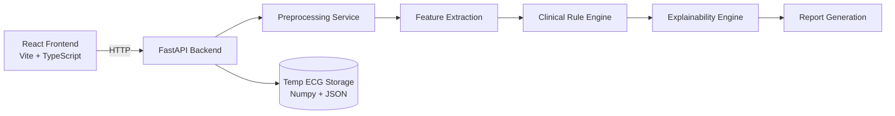

# MedQuantum-NIN

<p align="center">
  
</p>

<p align="center">
  <a href="LICENSE"></a>
  <a href=".github/workflows/ci.yml"></a>
  <a href="https://github.com/Tonyteja369/MedQuantum-NIN/issues"></a>
  <a href="https://github.com/Tonyteja369/MedQuantum-NIN/stargazers"></a>
</p>

Clinical-grade ECG analysis with explainable AI and a modern React dashboard.

> ⚠️ **Medical Disclaimer:** This repository is for research and clinical decision support. It is not a substitute for licensed medical diagnosis.

## Overview

MedQuantum-NIN combines a FastAPI backend for ECG preprocessing, feature extraction, rule-based diagnosis, and report generation with a React + TypeScript frontend for upload, analysis, and report visualization.

## Features

- Multi-format ECG ingestion (`.csv`, `.dat`, `.hea`, `.edf`)
- Signal preprocessing (notch, bandpass, baseline correction, smoothing)
- Deterministic rule-based diagnosis with reasoning traces
- Explainability-enhanced diagnostic support
- SOAP-style report generation and report export workflow
- Frontend dashboard with waveform, risk, confidence, and recommendations views
- Dockerized local deployment

## Screenshots

Screenshots are stored in [`docs/screenshots/`](docs/screenshots/).

- Dashboard: `docs/screenshots/dashboard.png`
- Upload: `docs/screenshots/upload.png`
- Analysis: `docs/screenshots/analysis.png`
- Report: `docs/screenshots/report.png`

## Architecture



More diagrams are available in [`docs/Architecture.md`](docs/Architecture.md).

## Tech Stack

- **Frontend:** React 18, TypeScript, Vite, Zustand, React Query, Recharts, Framer Motion
- **Backend:** FastAPI, Pydantic v2, NumPy, SciPy, NeuroKit2, WFDB, Loguru
- **DevOps:** Docker, Docker Compose, GitHub Actions

## Installation

### Prerequisites

- Node.js 20+
- Python 3.11+
- pip

### Frontend

```bash
npm ci
npm run dev
```

### Backend

```bash
cd backend
python -m pip install -r requirements.txt
uvicorn app.main:app --reload --host 0.0.0.0 --port 8000
```

## Docker Setup

```bash
docker compose up --build
```

- Frontend: http://localhost:5173
- Backend API docs: http://localhost:8000/docs

## Environment Variables

### Frontend (`.env.example`)

- `VITE_API_URL` (default: `http://localhost:8000/api`)

### Backend (`backend/.env.example`)

- `ENVIRONMENT`
- `API_HOST`
- `API_PORT`
- `LOG_LEVEL`
- `MAX_UPLOAD_SIZE_MB`
- `ALLOWED_ORIGINS`
- `WFDB_SAMPLE_DIR`
- `TEMP_DIR`
- `MODEL_VERSION`

## API Overview

Base URL: `/api`

- `POST /ecg/upload`
- `GET /ecg/samples`
- `POST /ecg/load-sample`
- `DELETE /ecg/signal/{signal_id}`
- `POST /analysis/analyze`
- `GET /analysis/result/{analysis_id}`
- `GET /analysis/features/{signal_id}`
- `POST /report/generate`
- `GET /report/export/{report_id}`
- `GET /health`

Full API details: [`docs/API.md`](docs/API.md)

## Project Structure

```text
MedQuantum-NIN/
├── .github/
│   ├── ISSUE_TEMPLATE/
│   └── workflows/
├── assets/
├── backend/
│   ├── app/
│   ├── tests/
│   └── Dockerfile
├── docs/
│   ├── images/
│   ├── screenshots/
│   └── *.md
├── src/
│   ├── api/
│   ├── components/
│   ├── hooks/
│   ├── pages/
│   ├── store/
│   ├── types/
│   └── utils/
├── docker-compose.yml
└── README.md
```

## Usage

1. Upload an ECG file or load a sample.
2. Run analysis.
3. Review diagnoses, metrics, and explainability.
4. Generate report for clinician and patient-facing summaries.

## Development Guide

See [`docs/Development.md`](docs/Development.md) for local workflows, lint/build/test commands, and contribution flow.

## Roadmap

See [`ROADMAP.md`](ROADMAP.md) and [`docs/Roadmap.md`](docs/Roadmap.md).

## FAQ

See [`docs/FAQ.md`](docs/FAQ.md).

## Contributing

Read [`CONTRIBUTING.md`](CONTRIBUTING.md) before opening issues or pull requests.

## License

This project is licensed under the terms of the [MIT License](LICENSE).

## Citation

 this project in research, cite it via [`CITATION.cff`](CITATION.cff).

## Contact

- Repository: https://github.com/Tonyteja369/MedQuantum-NIN
- Issues: https://github.com/Tonyteja369/MedQuantum-NIN/issues
