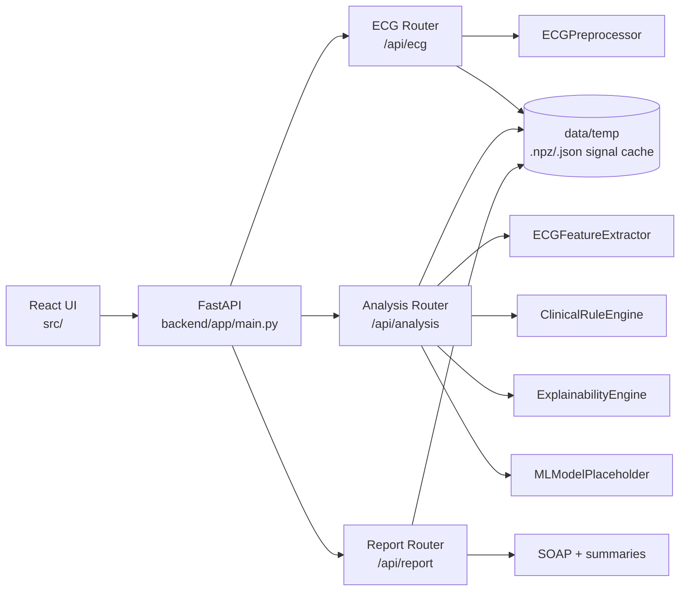
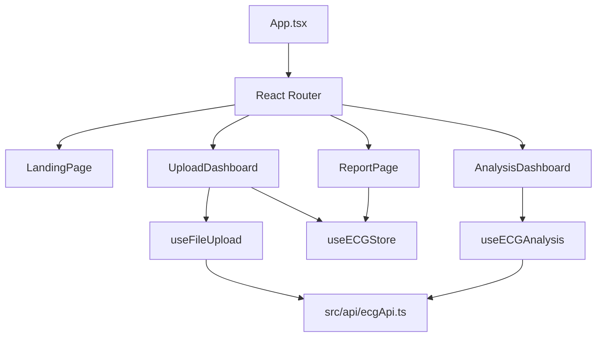
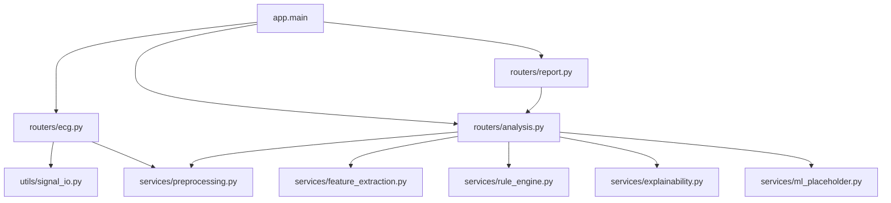
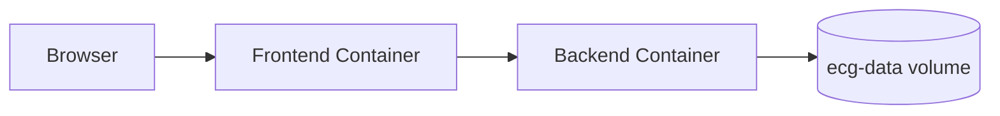

# Architecture

This document describes the implemented architecture in the current repository.

## System Architecture

## Frontend Architecture

## Backend Architecture

## Deployment Architecture

