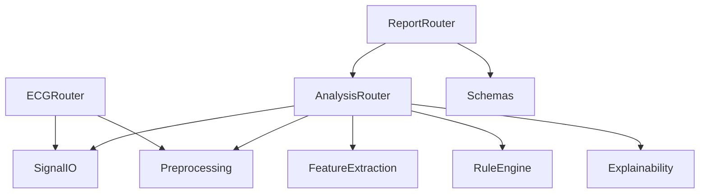

# Backend Documentation

Backend root: `backend/app/`

## Module Responsibilities

### `main.py`
- FastAPI app setup
- CORS and request logging middleware
- Router inclusion
- lifespan startup/shutdown tasks

### `core/`
- `config.py`: environment-driven settings and computed fields
- `logging.py`: Loguru sinks and request middleware

### `models/`
- `schemas.py`: Pydantic contracts for API input/output

### `routers/`
- `ecg.py`: ingestion, sample loading, and temporary signal cleanup
- `analysis.py`: analysis pipeline and result cache
- `report.py`: SOAP/summary generation and report cache

### `services/`
- `preprocessing.py`: signal cleanup and quality scoring
- `feature_extraction.py`: waveform feature computation
- `rule_engine.py`: deterministic clinical rule evaluation
- `explainability.py`: confidence calibration and reasoning enrichment
- `ml_placeholder.py`: future ML extension point

### `utils/`
- `signal_io.py`: WFDB/CSV loaders, validation, and temp signal persistence

## Relationships

