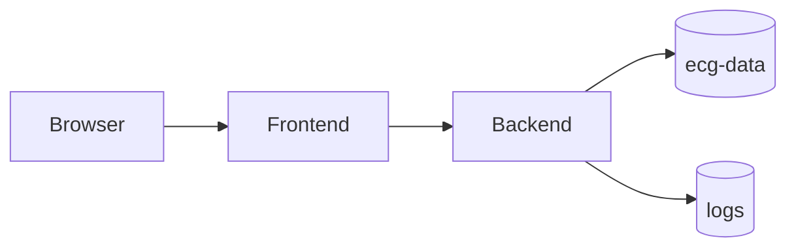

# Docker

## Files

- `backend/Dockerfile`: backend image build
- `Dockerfile`: frontend production image build
- `Dockerfile.frontend`: frontend dev server image
- `docker-compose.yml`: local multi-service orchestration

## Compose Services

- **backend**
  - builds from `backend/`
  - exposes `8000`
  - mounts persistent ECG data volume
  - has `/health` health check

- **frontend**
  - builds from root using `Dockerfile.frontend`
  - exposes `5173`
  - depends on healthy backend

## Docker Architecture

## Production Recommendations

- Build frontend with `Dockerfile` and serve static assets from nginx.
- Inject correct API base URL at build/runtime boundary.
- Set strict CORS allowed origins.
- Run regular vulnerability scanning on images.
