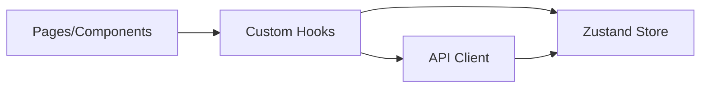

# Frontend Documentation

Frontend root: `src/`

## Architecture Overview

- Routing and app shell: `App.tsx`
- Pages:
  - `LandingPage.tsx`
  - `UploadDashboard.tsx`
  - `AnalysisDashboard.tsx`
  - `ReportPage.tsx`
- State management: Zustand store (`store/useECGStore.ts`)
- Server interactions: API client (`api/ecgApi.ts`) + React Query hooks

## Module Map

### `src/api/`
- **Purpose:** API wrappers over backend calls.
- **Responsibilities:** request config, upload progress, response/error normalization.
- **Dependencies:** `axios`, app domain types.

### `src/components/`
- **Purpose:** UI composition by domain (`landing`, `upload`, `analysis`, `report`, `layout`, `ui`).
- **Responsibilities:** present data, trigger hook/store actions.
- **Dependencies:** store hooks, utility formatters, charting libs.

### `src/hooks/`
- **`useFileUpload`**: upload lifecycle + preview fetch + dropzone integration.
- **`useECGAnalysis`**: analysis/report mutations + route transitions.
- **`useTheme`**: global theme synchronization.

### `src/pages/`
- Route-level orchestration for each dashboard step.

### `src/store/`
- **`useECGStore`** persists theme/layout preferences and holds upload/analysis/report state.

### `src/types/`
- Shared frontend domain contracts for ECG, analysis, report, and API wrappers.

### `src/utils/`
- Data formatting, colors, and signal-processing helpers for UI/demo flows.

## State Management

